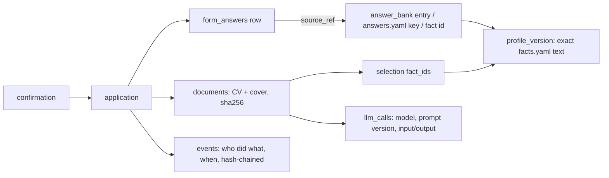
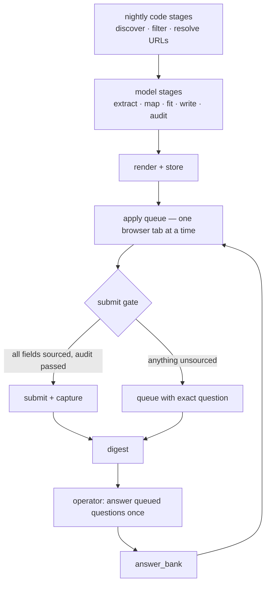

# Pipeline v2 — architecture

Goals, in priority order:
1. **Absolute traceability** — for any application, reproduce exactly what was sent, where every
   word/answer came from, which model or person produced it, and against which version of the facts.
2. **Minimal involvement** — the operator answers each genuinely new question once, ever;
   everything else runs without them.
3. **Cheapest capable model per task** — code first, small model for narrow checkable tasks,
   mid model only for prose, strongest model only for auditing.
4. Non-negotiable unchanged: every claim defensible solely from `profile/facts.yaml`; never guess.

## 1. Gaps v1 designs typically have

| Gap | Consequence |
|---|---|
| No version history | A past CV can't be proven against the `facts.yaml` it was built from once facts change |
| Records are loose files | Files can be overwritten or edited silently; no integrity check; no query ("what did I tell this employer about salary?") |
| Submitted-field capture not guaranteed | ATS autofill (some boards parse the CV into fields) is not captured unless explicitly snapshotted |
| No record of model work | FIT/TAILOR/DEFENSIBILITY outputs exist, but not which model, prompt version, or input |
| Every new question queues forever | The same question from the next employer queues again unless answers are banked by scope |
| Every run needs a chat session | A step-by-step agent session means the operator must start and supervise each batch |
| Scratch code mixed with real code | Unclear which files are real; slows every future change |

## 2. Principle: models may only choose, write, or judge inside a checkable contract

| Stage | Who | Output | Why this is safe |
|---|---|---|---|
| Discover, filter, dedupe, company cap | code | rows in `jobs` | deterministic |
| Extract requirements from JD | **small** model | `[{text, quote, required}]` | code rejects any `quote` not found verbatim in the JD |
| Map requirement → fact ids | **small** model | `fact_ids` per requirement | code rejects unknown ids; auditor re-checks later |
| FIT decision | **code** (rubric rules on extracted requirements: years, clearance, PhD, missing required tool) | pass/fail + reasons | rubric already deterministic in OPERATIONS.md; borderline → mid model |
| Fact selection + ordering for CV | **code** (rank by requirement coverage) | `selection.json` | only real fact ids, verbatim text |
| Summary + cover-letter prose | **mid** model | paragraphs with `fact_ids` | `validate.py` + template rules |
| Defensibility audit | **strong** model, different model from writer | pass / problems | adversarial check before anything renders |
| Render CV/cover | code | PDF/DOCX | deterministic |
| Form field → answer | **code** rules (`field_rules.mjs`) | value + source | already built |
| Unknown form question → answer bank key | **small** model | an existing bank key or `none` | model **picks**, never **writes** a value; value always comes from the bank |
| Fact-grounded essay ("why this role") | mid writes, strong audits | text with `fact_ids` | same gate as the cover letter |
| Submit gate, record, digest | code | — | deterministic |

A small model can never introduce new content: it quotes, maps to existing ids, or picks from
existing answers — and code verifies each output before it's used.

## 3. Data model — one SQLite database, append-only where it matters

`pipeline/data/pipeline.db` (extends the base `jobs.db` schema).

```
profile_versions(id, sha256, facts_yaml TEXT, answers_yaml TEXT, git_commit, created_at)
jobs(... existing ..., jd_sha256)                        -- JD text frozen at discovery
requirements(job_id, idx, text, quote, required, fact_ids, met, llm_call_id)
documents(id, job_id, kind cv|cover, format, sha256, store_path,
          selection_json, profile_version_id, llm_call_ids, audit_llm_call_id, created_at)
applications(id, job_id, attempt, status, apply_url, ats, profile_version_id, git_commit,
             cv_document_id, cover_document_id,
             screenshot_prefill_sha, screenshot_confirm_sha,
             confirmation_text, confirmation_url, started_at, submitted_at)
form_answers(application_id, idx, label, type, required, value, readback_value,
             source_kind fact|answers_yaml|bank|human|ats_autofill|untouched, source_ref, verified)
answer_bank(id, question, answer, scope global|company|job, company, created_by human|model,
            approved_by, approved_at, supersedes_id, fact_ids)   -- never edited; new row supersedes
llm_calls(id, stage, job_id, model, prompt_version, input_sha, output_json, output_sha,
          tokens_in, tokens_out, created_at)
events(seq, ts, actor, job_id, type, payload_json, prev_hash, hash)    -- hash-chained
```

**Content-addressed file store:** every uploaded file and screenshot is saved once as
`pipeline/store/<sha256[:2]>/<sha256>.<ext>` and never modified. `out/<job_id>/` becomes a
generated, human-browsable view of the database; editing it can't change the record.

**Hash-chained event log:** each event stores `hash = sha256(prev_hash + payload)`.
`verify_audit.py` recomputes the chain; any edited, deleted, or reordered event breaks it.

**Git** for code + `profile/` (excluding `data/`, `store/`, `out/`, credentials). Every
application stores the commit it ran under, so the exact code and facts are recoverable.

### Traceability chain (answering "why did I say X to company Y?")



## 4. Pre-submit capture (closes the ATS-autofill gap)

Immediately before clicking submit, snapshot **every** control on the form (not only the ones
the pipeline filled), with its read-back value, into `form_answers`. Fields the ATS autofilled
are recorded as `source_kind=ats_autofill` and must match a fact or be corrected; required fields
not touched block submission. Full-page screenshot before submit and after confirmation,
both stored by hash.

## 5. The answer bank (the biggest lever on involvement)

1. Unknown required question → small model tries to map it to an existing bank entry.
   Exact/normalized text match first (code), model only when no exact match.
2. No match → queued. The **daily digest** lists all queued questions from all jobs in one place.
3. The operator answers once, marks scope: `global` (nationality, reason for leaving, career
   ambitions — reused everywhere), `company`, or `job`.
4. Stored in `answer_bank` with `approved_by=human`; queued jobs re-run automatically.
5. Changing an answer adds a new row that supersedes the old one — past applications keep
   pointing at the exact answer they used.

## 6. Orchestration



- One command: `python run/batch.py` runs every stage in order, resumable from the
  state stored in the database (a crash resumes where it stopped).
- Code-only stages can run from Windows Task Scheduler with no session (`nightly.cmd`).
  `omp -p --mode json --model <m> --no-tools --no-session ...` runs headlessly and returns
  structured JSON (model, tokens, cost, actual model after any provider fallback) —
  `pipeline/ledger/llm.py` uses exactly this, so the model stages need no chat session either.
  Only the browser step still depends on the operator's own browser being open.
- The apply queue is a single worker (sequential browser rule, CONTRACTS.md).

## 7. Build phases

| Phase | Delivers | Involvement saved |
|---|---|---|
| P1 Traceability base | git init, ledger schema (`profile_versions`/`blobs`/`documents`/`applications`/`form_answers`/hash-chained `events`), `show.py`, `verify_audit.py` | — (foundation) |
| P2 Answer bank | `answer_bank`/`question_queue`, `map_question`/`classify_question` stages, `answer_question.py`, `answer_bank.json` export consumed by `field_rules.mjs` | each question answered once, reused by scope |
| P3 Tiered model stages | `requirements` (small, verbatim-quote checked) + `fit_rules` (pure code) + `select` (pure code) + `writer`/`auditor` split, every call logged in `llm_calls` with requested vs. actual model | no manual FIT review; cheap model for narrow tasks |
| P4 Pre-submit capture | `runner.mjs` snapshots every control, checks ATS-autofilled values against facts/answers, screenshots before submit and after confirmation | trust in auto-submit |
| P5 One-command batch | `batch.py` (lock, backup, git snapshot, resumable via `jobs.status`), `nightly.cmd` | no step-by-step supervision |

## 8. Decisions

1. **Auto-submit: off by default** (`config.yaml` `auto_submit: false`). `tailored` jobs dry-run to
   `ready`; `python run/approve.py <job_id>` (or `--all-ready`) approves, freezing the exact
   answers just filled — the next batch submits only if nothing has drifted since. Turn on once
   there's a track record of `ready` jobs matching what the operator would have approved anyway.
2. **Fact-grounded "why this role/company" answers: on** (`generate_fact_grounded_answers: true`).
   The writer drafts, a different, stronger model audits against the same defensibility rubric as
   the CV/cover letter (OPERATIONS.md); only an audit-passed answer joins the bank. Personal
   questions (opinions, nationality, preferences, anything not answerable from facts) always queue
   for the operator regardless of this setting.
3. **git**: a fresh repo per deployment. `.gitignore` excludes `profile/answers.yaml`,
   `profile/facts.yaml` and other personal artefacts, plus `data/`, `store/`, `out/`, `work/`,
   `node_modules/`. `batch.py` auto-commits any uncommitted change before each run so every
   application record points at an exact, recoverable commit.
